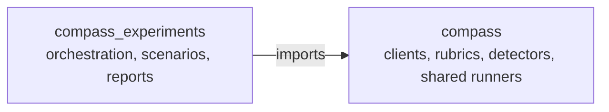
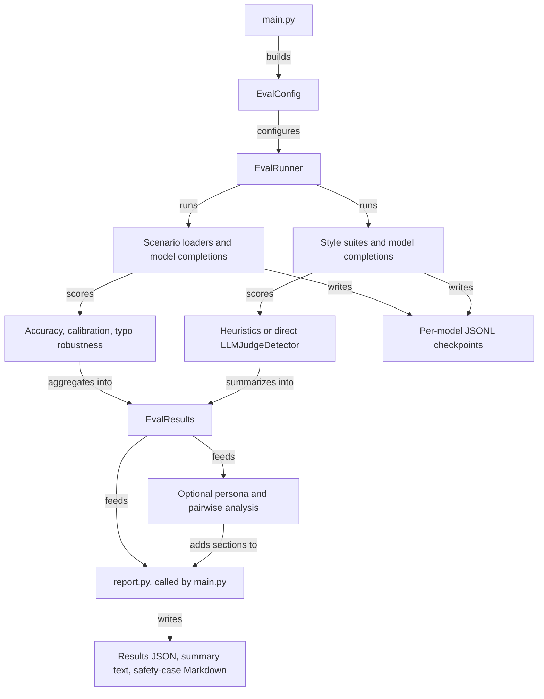
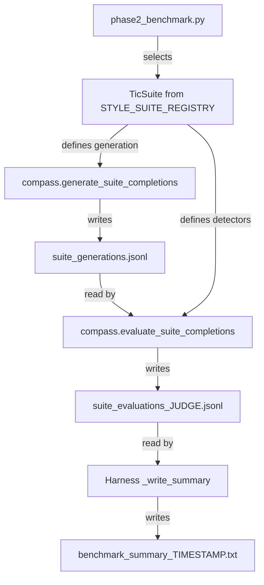

# Compass Experiments Architecture

`compass_experiments` runs scenario benchmarks, style experiments, and reports
using shared Compass primitives. It has two CLI execution paths with different
scoring and persistence behavior.

## Repository dependency

The arrow means “imports from.” Compass does not import this repository.

Compass owns the shared detector framework and constitutional suite definitions.
The harness also contains local style and LinkedIn suites, scenario metrics,
and pairwise/persona analysis helpers. New reusable primitives belong in
Compass; the current local helpers are implementation details, not evidence
that every analysis path delegates to the library.

## Main CLI: scenarios and style analysis

`python -m compass_experiments.main` builds an `EvalConfig` and calls
`EvalRunner`. Arrows below describe execution stages and the data they produce.

The client factory in `compass_experiments/models/__init__.py` selects thin
adapters over Compass clients. The main CLI routes cloud models; the phase2
factory also recognizes supported Ollama models.

For an LLM detector, `_run_tic_suite` supplies a `judge_fn` that calls the judge
client. `LLMJudgeDetector.detect_with_judge` builds and parses the request.
This path does not use Compass's cached `LLMJudge`. It passes the saved user
request alongside the completion, and the detector records that context in its
metadata. Optional secondary judging receives the same saved request.
Generation system instructions are omitted from judging by default.

Main-CLI checkpoints live under `<output-dir>/checkpoints/`; aggregate reports
live at the output root. The offline `--pairwise-from-results` route reads the
aggregate JSON and its referenced checkpoints, then writes pairwise reports
without generating or judging new completions.

## Phase2 CLI: saved generations and separate scoring

`python phase2_benchmark.py` selects suites from the harness's
`STYLE_SUITE_REGISTRY` and calls Compass's suite APIs. It does not use
`SharedBenchmarkRunner` or the main CLI's `EvalRunner`.

Arrows show the flow of definitions and persisted records between phases.

Compass runs heuristic detectors directly. For LLM detectors, its suite runner
constructs a `Rubric` and cached `LLMJudge` from the detector definition, then
passes the saved completion and original user prompt to `evaluate`. This
produces `EvaluationResult` values which the runner writes into detector rows;
it does not call `LLMJudgeDetector.detect_with_judge`.

Generation and evaluation files live under `<output-dir>/<suite>/`; judge-cache
files live in that suite directory's `.cache/`. Heuristic-only suites use
`suite_evaluations_heuristic.jsonl`. The text summary stays at the output root.

## Persistence and scoring boundaries

The two CLIs share definitions and clients, but not identical scoring paths or
checkpoint formats. Main-CLI style records combine generations and detector
results; phase2 persists those phases separately. Compass's `BenchmarkSpec`
runner is a third API with its own benchmark artifacts and validation policy.

Main-CLI style checkpoints and phase2 suite rows validate input fingerprints.
Changed definitions require a fresh output directory or explicit rescoring;
legacy rows cannot silently resume. The main style runner saves requested sample
identities and generations in sidecars before judging, so failures can be retried
without dropping planned samples or replacing their responses. Phase2 uses
Compass manifests to verify generation and evaluation coverage.

Both LLM judge paths reject invalid scores and derive `hit` from their configured
threshold. Prompt context still differs: main-CLI judges see completion text,
while phase2 judges also receive the user request. Use phase2 for prompt-dependent
rubrics such as unsolicited advice. Dataset-scenario and Compass BenchmarkSpec
checkpoints retain their separate identity-based resume limitations.

## Key files

- [main.py](compass_experiments/main.py): CLI configuration and report calls
- [runner.py](compass_experiments/runner.py): scenario and style execution
- [runner_support.py](compass_experiments/runner_support.py): checkpoint loading and aggregation
- [models/](compass_experiments/models/): adapters over Compass clients
- [metrics/](compass_experiments/metrics/): local suites, metrics, and analysis helpers
- [scenarios/](compass_experiments/scenarios/): dataset loaders
- [phase2_benchmark.py](phase2_benchmark.py): two-phase suite orchestration
- [report.py](compass_experiments/report.py): JSON, text, and safety-case reports

See [PHASE2_BENCHMARK.md](PHASE2_BENCHMARK.md) for CLI usage and
[Compass's architecture](https://github.com/prathibha-github/compass/blob/main/ARCHITECTURE.md)
for shared-library internals.
