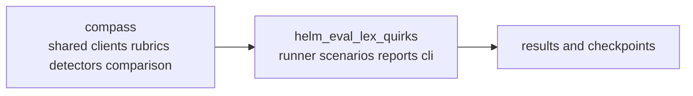
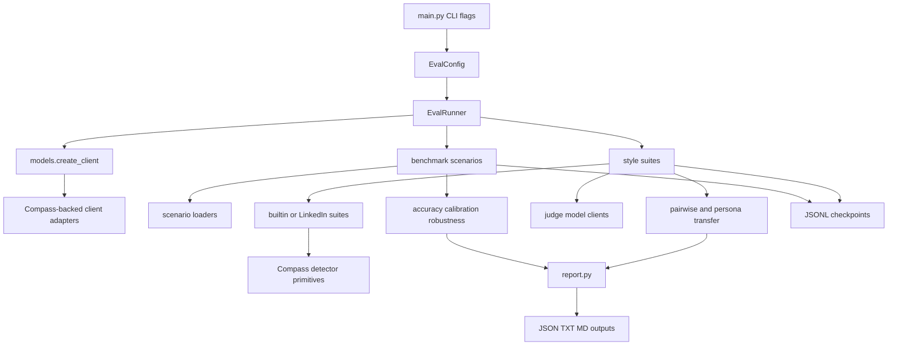

# HELM Eval Lex Quirks Architecture

`helm_eval_lex_quirks` is the execution layer that runs scenario evals, style
suite evals, pairwise analysis, and reporting on top of shared Compass
primitives.

## Repo Boundary

## Main Evaluation Flow

## Key Files

- `helm_eval_lex_quirks/main.py`: CLI entrypoint and config wiring
- `helm_eval_lex_quirks/runner.py`: main orchestration path
- `helm_eval_lex_quirks/models/`: thin adapters over Compass clients
- `helm_eval_lex_quirks/metrics/`: suite wiring, reporting helpers, pairwise logic
- `helm_eval_lex_quirks/scenarios/`: dataset-specific loaders
- `phase2_benchmark.py`: focused constitutional benchmark runner
- `report.py`: text, JSON, and safety-case report output

## Boundaries

- Shared primitives should be added to `compass` first.
- Repo-local changes here should stay focused on orchestration, scenario
  loading, reporting, and one-off evaluation flows.
